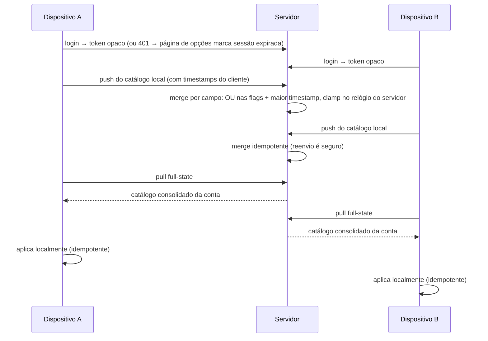

# NoReplay - Plan

## Goal Capsule

- **Objective:** Vídeos do YouTube que você já assistiu são pulados na abertura com 5 segundos de chance para assistir de novo — e esse comportamento vale em qualquer dispositivo em que você esteja logado.
- **Means:** Extensão Firefox que detecta, avisa e pula; backend em Go que guarda o catálogo por conta e o sincroniza entre dispositivos (KTD3, KTD6, KTD8).
- **Product authority:** Pedido pessoal do usuário — ferramenta de uso próprio, conta única, escopo definido neste documento.
- **Execution profile:** code.
- **Open blockers:** nenhum.

## Product Contract

### Summary

Extensão Firefox mais backend em Go. A extensão detecta na página do vídeo que o conteúdo já foi assistido, exibe um popup de 5 segundos e, sem clique, inicia o próximo vídeo sugerido — clicando, deixa o vídeo tocar. O catálogo começa local e sincroniza por conta pessoal para valer em todos os dispositivos do usuário. O backend é entregue com Dockerfile e manifests do Kubernetes.

### Problem Frame

Cair de novo em um vídeo já assistido hoje termina em clique manual no botão de avançar ou na escolha de outra sugestão da coluna lateral. O custo é pequeno por vídeo, mas se repete toda sessão: nada lembra o que já foi visto, e o descarte é sempre manual.

### Key Decisions

- **Skip somente na página do vídeo** (session-settled: user-directed — chosen over appearing on list cards: "pular para o próximo" só existe onde há player). Governs R4, R5, R6, R7.
- **Assistido por limiar de tempo** (session-settled: user-directed — chosen over open-page, completion, and manual marking: evita marcar quem só abriu e saiu). Governs R1.
- **Local-first com conta opcional** (session-settled: user-directed — chosen over mandatory login: a extensão já resolve sozinha antes do backend existir). Governs R3, R9.
- **Conta pessoal com e-mail e senha** (session-settled: user-directed — chosen over public multiuser accounts and Google login: escopo pessoal, sem superfície de produto aberto). Governs R8.
- **Catálogo existe só para o skip** (session-settled: user-directed — chosen over a browsable history: o valor é não repetir, não revisitar).
- **Popup de 5 segundos** (session-settled: user-approved — default proposto pelo agente para o "X segundos" em aberto; usuário assentiu). Governs R4, R5.
- **Pular dispara o próximo vídeo sugerido mesmo com autoplay desligado** (session-settled: user-approved — inferência do agente confirmada pelo usuário). Governs R5.
- **A exceção "nunca pular" sincroniza junto com o catálogo** (session-settled: user-approved — inferência do agente confirmada pelo usuário). Governs R7, R9.
- **Limiar acumula entre sessões** (session-settled: user-approved — o agente escolheu a opção mais fácil a pedido do usuário, chosen over zerar a cada abertura: acompanha a posição de retomada que o YouTube já guarda). Governs R1.
- **Exceção marcada durante o popup não interrompe o vídeo atual** (session-settled: user-directed — chosen over efeito imediato no player: coerente com o usuário sempre poder assistir). Governs R7.
- **Logout mantém o catálogo local e a sincronização para até o próximo login** (session-settled: user-directed — chosen over apagar o local no logout: o catálogo local continua funcionando sem conta). Governs R3, R10.
- **Merge de conflito: exceção vence, resto por timestamp mais recente** (session-settled: user-directed — chosen over LWW puro: protege a exceção de um dispositivo desatualizado). Governs R11.
- **Cadastro restrito a um único e-mail configurado** (session-settled: user-directed — chosen over cadastro aberto: caminho mais fácil para o MVP pessoal). Governs R8.
- **Sem recuperação de senha no MVP** (session-settled: user-directed — chosen over fluxo de reset por e-mail: evita SMTP e infra extra; perdendo a senha, perde-se só o sync).
- **Deploy do backend via Dockerfile + manifests do Kubernetes** (session-settled: user-directed — chosen over apenas binário local ou deploy gerenciado: pedido explícito do usuário). Governs R12.

### Actors

- A1. Usuário — dono da conta; assiste vídeos e decide quando um replay é permitido.
- A2. Backend — guarda catálogos por conta e os entrega aos dispositivos logados.
- A3. Página do YouTube — superfície externa em que a extensão atua; fora do controle do projeto.

### Key Flows

- F1. Skip na página do vídeo
  - **Trigger:** Usuário abre a página de um vídeo.
  - **Actors:** A1, A3
  - **Steps:** Extensão consulta o catálogo local; sem registro, o vídeo toca normalmente. Com registro e sem exceção, o popup aparece por 5 segundos; sem clique, inicia o próximo vídeo sugerido; com clique, o vídeo toca; marcando a exceção, o catálogo local grava "nunca pular" e o vídeo segue tocando.
  - **Outcome:** Replay evitado, ou autorizado explicitamente.
  - **Covers:** R1, R2, R4, R5, R6, R7
- F2. Captura de vídeo assistido
  - **Trigger:** Reprodução acumula 30 segundos ou 25% da duração, o que for menor.
  - **Actors:** A1, A3
  - **Steps:** Extensão grava o vídeo no catálogo local; sincroniza com a conta quando logado.
  - **Outcome:** O vídeo passa a valer skip nos próximos acessos, neste e nos demais dispositivos.
  - **Covers:** R1, R2, R9
- F3. Conta e sincronização
  - **Trigger:** Usuário cria conta ou faz login.
  - **Actors:** A1, A2
  - **Steps:** Catálogo local sobe para a conta; os demais dispositivos logados recebem as mudanças a partir da próxima sincronização com sucesso — skip entre dispositivos vale do sync seguinte em diante, nunca antes. Alterações futuras, inclusive novos vídeos e exceções, propagam entre dispositivos. No logout, o catálogo local permanece e o sync fica suspenso até o próximo login.
  - **Outcome:** Mesmo estado de skip em todos os dispositivos da conta.
  - **Covers:** R3, R8, R9, R10

### Requirements

**Detecção e catálogo local**

- R1. A extensão marca um vídeo como assistido quando a reprodução acumula 30 segundos ou 25% da duração, o que for menor. O limiar só é cruzado por reprodução ativa na sessão atual — abrir em posição avançada ou pular na barra não conta por si só; o tempo assistido persiste por vídeo e acumula entre sessões.
- R2. O catálogo local guarda, por vídeo, a marca de assistido e a exceção "nunca pular".
- R3. Sem login, detecção, skip e exceções funcionam inteiramente no dispositivo.

**Skip na página do vídeo**

- R4. Ao abrir um vídeo assistido sem exceção, um popup é exibido sobre o player por 5 segundos.
- R5. Sem interação em 5 segundos, a extensão inicia o próximo vídeo sugerido, mesmo com o autoplay desligado.
- R6. Clicar no popup cancela o skip e deixa o vídeo tocar.
- R7. O popup oferece um checkbox "nunca pular esse vídeo", cuja marcação impede skips futuros daquele vídeo. Marcada durante o popup, não interrompe o vídeo em reprodução.

**Conta e sincronização**

- R8. O backend oferece conta pessoal com e-mail e senha, com cadastro restrito a um único e-mail configurado, e isola o catálogo de cada conta.
- R9. Ao entrar na conta, o catálogo local é incorporado ao catálogo da conta, e a sincronização passa a valer entre todos os dispositivos logados — vídeos e exceções — a partir da próxima sincronização com sucesso.
- R10. No logout, o catálogo local permanece no dispositivo e a sincronização para até o próximo login.
- R11. Em divergência entre dispositivos sobre o mesmo vídeo, a exceção "nunca pular" sempre prevalece; o merge é por campo, a exceção é uma flag que liga por OU e a recência vale para os timestamps (KTD6).

**Empacotamento e operação**

- R12. O backend é entregue com Dockerfile e manifests do Kubernetes para implantação.

### Acceptance Examples

- AE1. **Covers:** R4, R5. **Given:** o vídeo já está no catálogo, sem exceção. **When:** o usuário abre a página e não interage com o popup por 5 segundos. **Then:** o próximo vídeo sugerido começa a tocar.
- AE2. **Covers:** R6. **Given:** o popup está visível. **When:** o usuário clica nele. **Then:** o skip é cancelado e o vídeo atual toca.
- AE3. **Covers:** R7. **Given:** o usuário marcou "nunca pular" no popup. **When:** ele reabre o mesmo vídeo depois. **Then:** não há popup nem skip.
- AE4. **Covers:** R1. **Given:** o vídeo foi aberto e abandonado antes do limiar. **When:** ele é reaberto depois. **Then:** não há popup — o vídeo não foi catalogado.
- AE5. **Covers:** R8, R9. **Given:** a mesma conta está logada nos dispositivos A e B, e ambos concluíram uma sincronização depois que o vídeo cruzou o limiar no A. **When:** o vídeo é assistido no A até o limiar. **Then:** abrindo-o no B, o popup de skip aparece.
- AE6. **Covers:** R3. **Given:** a extensão está sem login. **When:** um vídeo assistido é reaberto. **Then:** detecção, popup, skip e exceções funcionam normalmente.
- AE7. **Covers:** R10. **Given:** o usuário está logado com catálogo sincronizado. **When:** ele faz logout. **Then:** os vídeos assistidos locais continuam sendo pulados e as mudanças locais ficam em espera até o próximo login.
- AE8. **Covers:** R11. **Given:** o dispositivo A marcou "nunca pular" e o dispositivo B registrou o vídeo como assistido depois. **When:** ambos sincronizam. **Then:** nos dois dispositivos o vídeo nunca é pulado automaticamente.

### Scope Boundaries

**Deferred for later**

- Página de histórico navegável e estatísticas de consumo.
- Gestão do catálogo (desfazer marcação manual, limpar registros) — enquanto isso, o merge monotônico (KTD6) é válido; desmarcar exige tombstone.
- YouTube Shorts — comportamento decidido depois que o watch padrão estiver funcionando.
- Fluxo de recuperação de senha.
- Exclusão de conta e dos dados no servidor — o catálogo no servidor é histórico de visualização (dado sensível) e fica retido enquanto a conta existir.
- Troca de senha com revogação das demais sessões (sem SMTP, usando a senha atual) — decidido fora do MVP junto com "Sem recuperação de senha"; sem ela, o único caminho de remediação após comprometimento da senha é o TTL de 30 dias. Reavaliar se a conta passar a guardar dados mais sensíveis.

**Outside this product's identity**

- Alterar cards, recomendações ou listas da home, busca e inscrições — o skip acontece só na página do vídeo.
- Bloquear reprodução sem saída; o usuário sempre pode assistir escolhendo no popup.
- Produto multiusuário aberto ou login com conta Google.

### Dependencies / Assumptions

- O YouTube pode mudar a estrutura da página e quebrar a detecção; a resposta aceita é atualizar a extensão quando isso acontecer — não há plano alternativo.

---

## Planning Contract

### Key Technical Decisions

- KTD1. Extensão MV3 com `background.scripts` (event page) em vez de `service_worker` — Firefox MV3 não implementa `service_worker` (bug Mozilla 1573659); o event page é o formato suportado.
- KTD2. Detecção de navegação por `webNavigation.onHistoryStateUpdated` mais o evento `yt-navigate-finish` do SPA do YouTube — a URL muda sem reload, então navegação tradicional de página não dispara nada (KTD1, R4).
- KTD3. Skip acionando o controle "próximo" do player do YouTube (session-settled: user-approved — chosen over montar a URL da próxima sugestão manualmente: funciona com autoplay desligado e herda a fila de sugestões do próprio YouTube; instancia a Key Decision "Pular dispara o próximo vídeo sugerido", Governs R5).
- KTD4. Autenticação por token opaco: extensão guarda o token em `storage.local` e o envia em `Authorization`; servidor valida contra tabela de sessões; senhas com argon2id (session-settled: user-approved — chosen over cookies, frágeis em contexto de extensão, e JWT, sem revogação simples: pesquisa de melhores práticas para APIs de extensão; Governs R8, R9). Ciclo de vida do MVP: token gerado no servidor por CSPRNG com pelo menos 128 bits de entropia, guardado no banco apenas como hash SHA-256 (vazamento do banco não entrega sessões vivas), TTL absoluto de 30 dias sem refresh (expirou, refaz login — não há reset de senha como segunda via); `storage.local` persiste o token no perfil como risco residual aceito de máquina compartilhada, contido pelo TTL e pelo logout; o token nunca aparece em URL, query string ou log. Origem: a extensão só envia o token para `https`, com exceção de desenvolvimento para loopback (`localhost`/`127.0.0.1`/`::1`), que não é origem de produção.
- KTD5. Stack backend: `net/http` nativo com routing 1.22+ e SQLite via driver sem CGO (`modernc.org/sqlite`) — menos dependências e build mais simples que framework externo ou driver com CGO (Governs R8, R12).
- KTD6. Merge de catálogo no servidor, campo a campo: as flags "assistido" e "nunca pular" combinam por OU monotônico e cada timestamp fica com o maior valor, normalizado por clamp — timestamp futuro é aparado para o relógio do servidor, e timestamps antigos nunca são reescritos (reescrever no ingest destruiria a ordenação do cliente). Como join comutativo, associativo e idempotente sobre escritas serializadas do SQLite, pushes concorrentes de dois dispositivos convergem. A monotonicidade só é correta enquanto "desfazer marcação" fica fora do escopo (Scope Boundaries): quando entrar, exige tombstone/versionamento, senão um dispositivo defasado ressuscita a marca. (session-settled: user-directed — instancia a Key Decision "exceção vence, resto por timestamp mais recente", Governs R11; chosen over merge no cliente: estado único entre dispositivos sem ida volta.)
- KTD7. Sincronização best-effort em background: push do catálogo local e pull do consolidado tentam após eventos de navegação e no login, com retry natural no próximo evento; falha de rede nunca bloqueia detecção, skip ou gravação local (session-settled: user-approved — instancia a Key Decision "Local-first com conta opcional", Governs R3, R9, R10). O motor é sem estado pendurado: nada depende de timers (`alarms` desnecessário), push interrompido pela suspensão do event page é descartado e re-tenta no evento seguinte, e o merge idempotente (KTD6) torna o reenvio seguro.
- KTD8. Gate de cadastro por e-mail único configurado por variável de ambiente, com e-mail normalizado (caixa e espaços) antes da comparação — implementa a Key Decision "Cadastro restrito a um único e-mail" (session-settled: user-directed, Governs R8). Fail-closed: variável ausente ou vazia desabilita o cadastro; a recusa é indistinguível entre os casos e não revela o valor do allowlist. É o oposto deliberado do fail-open da detecção — fail-open é certo para não atrapalhar o usuário, fail-closed é certo para uma porta de segurança.
- KTD9. Protocolo de sync full-state no pull: o servidor devolve o catálogo consolidado inteiro da conta, sem cursor — chosen over pull incremental por cursor: o catálogo pessoal é pequeno (centenas a poucos milhares de registros curtos), o que elimina estado de cursor no cliente, tiebreaks de timestamp e o caso especial de resync no primeiro login ou após logout (Governs R9, R10).

### High-Level Technical Design

Os três componentes e a fronteira de confiança entre eles:

O background é o dono único de `storage.local` (catálogo e token) — content scripts e página de opções só o alcançam por mensagens, evitando read-modify-write concorrente entre abas.

```mermaid
flowchart TB
  subgraph FF[Firefox — extensão]
    BG[background event page<br/>KTD1 — dono único do storage]
    NAV[content: navegação e progresso<br/>KTD2]
    POP[overlay: popup de skip]
    OPT[página de opções: conta]
    TOK[(storage.local<br/>token de sessão, KTD4)]
    SYNC[motor de sync<br/>best-effort, KTD7]
    ST[(storage.local<br/>catálogo)]
    BG --> ST
    BG --> TOK
    BG --> SYNC
    NAV -- mensagem --> BG
    POP -- mensagem --> BG
    OPT -- mensagem --> BG
  end
  subgraph YT[Página do YouTube — fora do controle]
    YT
  end
  subgraph BE[Backend — Go]
    API[net/http API<br/>auth + sync]
    MG[merge de catálogo<br/>KTD6]
    DB[(SQLite)]
    API --> MG --> DB
  end
  YT -- eventos de SPA --> NAV
  POP -- clicar no controle "próximo" --> YT
  SYNC -- Authorization: token opaco sobre https --> API
```

Caminho de decisão do skip (KTD3, R4–R7):

```mermaid
flowchart TB
  A[Vídeo aberto] --> B{Assistido no catálogo<br/>e sem exceção?}
  B -- não --> C[Vídeo toca normalmente]
  B -- indeterminado<br/>fail-open --> C
  B -- sim --> D[Popup por 5s sobre o player]
  D --> E{Interação?}
  E -- clique --> C
  E -- marca exceção --> F[Grava "nunca pular"<br/>vídeo segue tocando]
  E -- timeout --> G[Clica no controle "próximo"]
  G --> H{Existe próximo?}
  H -- sim --> I[Próximo vídeo inicia]
  H -- não --> C
```

Sequência de sincronização (KTD6, KTD7, KTD9, R9–R11). O ciclo é simétrico — os dois dispositivos fazem push e pull; o pull devolve o catálogo consolidado inteiro (full-state, KTD9):



### Sequencing

Duas faixas independentes seguidas pela integração; a faixa de extensão é executável e verificável sem backend nenhum (R3).

1. **Extensão local (U1 → U2 → U3)** — scaffold, detecção/progresso, popup. Entrega o produto funcionando offline.
2. **Backend (U4 → U5 → U6)** — scaffold/schema, conta, API de sync. Pode começar em paralelo à faixa 1.
3. **Integração e operação (U7 → U8)** — extensão loga, sincroniza; empacotamento Docker/K8s.

Dependências: U4 e U1 não têm pré-requisitos; U2←U1; U3←U2; U5←U4; U6←U4, U5; U7←U3, U6; U8←U6.

### Deferred Implementation Notes

- Seletores exatos do DOM do YouTube para player, duração e controle "próximo" — definir contra a página real durante U1–U3.
- Formato exato dos campos da API de sync — definir no contrato de teste de U6; contrato aditivo, cliente ignora campos desconhecidos (System-Wide Impact).
- Política de retry/backoff do sync — calibrar em U7; o TTL de sessão (30 dias, KTD4) não fica em aberto.
- Shorts e demais formatos — fora do escopo até o watch padrão estar estável (Scope Boundaries).
- Countdown do popup em aba oculta/desfocada — decidir em U3 se a contagem é limitada à aba visível/focada antes de o auto-skip disparar (pergunta de design em aberto; comportamento padrão definido nos Test scenarios de U3 até lá).
- Chave do rate limit pré-autenticação — decidir em U5 se conta (e-mail normalizado) ou IP, e como ler o IP real atrás do Ingress sem aceitar `X-Forwarded-For` forjado; o rate limit é exigido, a chave fica em aberto.
- Descoberta de sessão expirada — hoje visível só na página de opções quando 401 é recebido (U7); avaliar sinal fora dela (ex.: badge da extensão) numa iteração futura.

---

## Implementation Units

### U1. Extensão: scaffold MV3 e detecção de navegação

- **Goal:** Extensão carrega no Firefox MV3 com event page ativo e emite, para cada navegação SPA até uma página de vídeo, o identificador do vídeo e a duração atual.
- **Requirements:** R2, R3 (base de armazenamento e operação local); pré-condição de R1, R4.
- **Dependencies:** nenhuma.
- **Files:** `extension/manifest.json`, `extension/background.js`, `extension/content/navigator.js`, `extension/storage/catalog.js`, `extension/tests/navigation.test.js`, `extension/tests/catalog.test.js`
- **Approach:**
  1. Manifest MV3 declarando `background.scripts` (KTD1), permissões `storage`, `webNavigation` e host `youtube.com`; sem `service_worker`.
  2. Event page escuta `webNavigation.onHistoryStateUpdated` em youtube.com e content script despacha o evento interno de navegação do SPA (KTD2), cobrindo ida da home/lista para `/watch` e troca entre vídeos sem reload.
  3. Catálogo local em `storage.local`, um registro por vídeo com marca de assistido, exceção "nunca pular" e timestamps de atualização (R2); o background é o dono único do storage — content scripts mandam mensagens em vez de gravar direto.
  4. O id do vídeo é sempre corroborado pela URL observada pelo navegador (`webNavigation`), nunca aceito só do evento disparado pela página (A3 é gatilho, não fonte de dado) — a página pode disparar eventos falsos.
  5. API de catálogo no background, isolada de UI — é o módulo que U2 e U3 consomem por mensagem.
- **Execution note:** Comece com um teste falho que uma navegação SPA da home para `/watch` produz um evento com o id do vídeo.
- **Patterns to follow:** Convenções de extensão WebExtension da documentação MDN; nenhum código existente no repositório.
- **Test scenarios:**
  - Navegar da home para `/watch?v=abc123` sem reload dispara evento com id `abc123`.
  - Trocar de um vídeo para outro na mesma sessão dispara evento com o novo id.
  - Navegar para página que não é vídeo (resultados de busca) não dispara evento de vídeo.
  - URL `/watch` com parâmetros extras (`&t=42s&list=...`) extrai o id corretamente.
  - Evento de navegação falso, com id arbitrário, disparado pela página não cria registro no catálogo — o id vem da URL verificada.
  - Dois content scripts (abas diferentes) pedindo gravação ao mesmo tempo não perdem atualização — write serializado no background.
  - Gravar e reler um registro no catálogo preserva marca e exceção.
  - Event page suspensa e reativada pelo navegador: os listeners são re-registrados na ativação (top-level no script), então as navegações SPA seguintes voltam a ser capturadas.
- **Verification:** `web-ext run` carrega sem erros no console; navegar home → vídeo → outro vídeo sem reload gera os três eventos esperados no log de teste.

### U2. Extensão: progresso e catálogo local

- **Goal:** Reprodução acumulada cruza o limiar e o vídeo é catalogado como assistido, entre sessões.
- **Requirements:** R1, R2, R3; materializa F2.
- **Dependencies:** U1.
- **Files:** `extension/content/progress.js`, `extension/storage/catalog.js`, `extension/tests/progress.test.js`
- **Approach:**
  1. Content script acumula segundos de reprodução ativa na sessão atual e persiste o total por vídeo entre sessões (Key Decision "Limiar acumula entre sessões", Governs R1); a posição de retomada do YouTube não conta sozinha — abrir em `t=` ou pular na barra não aproxima o limiar.
  2. Limiar = menor entre 30s e 25% da duração (R1); ao cruzar, o content script pede ao background a gravação da marca de assistido com timestamp.
  3. Fail-open: duração ou tempo indeterminados → nada é gravado; exceção "nunca pular" nunca é sobrescrita por esta rotina.
- **Test scenarios:**
  - Vídeo de 200s: marca ao atingir 30s de reprodução acumulada.
  - Vídeo de 20s: marca ao atingir 5s (25% da duração é menor que 30s).
  - Sessão de 20s interrompida + reabertura que soma 15s → marca (acumulação entre sessões).
  - Abandono abaixo do limiar em todas as sessões → nunca marca. Covers AE4.
  - Duração desconhecida durante toda a reprodução → não marca (fail-open).
  - Abrir via deep link `?t=42s` sem reproduzir além do ponto → não marca; só a reprodução ativa soma.
  - Vídeo já marcado → estado permanece assistido.
- **Verification:** Testes unitários do limiar e da acumulação passam; em smoke manual, assistir além do limiar e reabrir o vídeo mostra o vídeo no catálogo.

### U3. Extensão: popup de skip e exceção

- **Goal:** Página de vídeo assistido sem exceção mostra o popup de 5s; timeout pula, clique cancela, checkbox grava a exceção.
- **Requirements:** R4, R5, R6, R7; materializa F1.
- **Dependencies:** U2.
- **Files:** `extension/content/skip.js`, `extension/content/skip.css`, `extension/storage/catalog.js`, `extension/tests/skip.test.js`
- **Approach:**
  1. Overlay sobre o player quando o catálogo marca assistido e não há exceção (R4); se o estado do vídeo estiver indeterminado, não mostra popup nem pula (fail-open).
  2. Timer de 5s: timeout dispara clique no controle "próximo" do player (KTD3, R5); sem próximo disponível, o popup expira e o vídeo atual segue.
  3. Clique em qualquer ponto do popup cancela o timer e libera o vídeo (R6); o checkbox é uma ação distinta que grava "nunca pular" — nos dois casos o vídeo continua tocando, apenas a exceção muda o futuro (R7).
  4. Popup existe só na página do vídeo (Key Decision "Skip somente na página do vídeo", Governs R4–R7).
  5. Qualquer evento de navegação SPA (KTD2) descarta o popup e limpa o contador pendente antes de avaliar o novo vídeo — o timeout é amarrado ao vídeo que o originou, então uma troca de vídeo durante a contagem nunca clica em "próximo" sobre um vídeo que não mostrou popup.
  6. O popup mostra um contador regressivo visível dos segundos restantes e um aviso de que o próximo vídeo sugerido começa sozinho ao chegar a zero — a "chance de assistir de novo" só existe se for percebida antes de expirar.
  7. Acessibilidade: o popup é dispensável por Enter/Espaço e Escape, o checkbox "nunca pular" é alcançável por Tab, e uma região aria-live anuncia o popup e o auto-skip pendente.
- **Test scenarios:**
  - Vídeo assistido, sem interação por 5s → clique disparado no controle "próximo". Covers AE1.
  - Clique no popup durante a contagem → timer cancelado, vídeo liberado. Covers AE2.
  - Marcar exceção → registro gravado; reabrir o vídeo → sem popup. Covers AE3.
  - Marcar exceção durante o popup → vídeo atual não é interrompido.
  - Autoplay desligado → skip ainda inicia o próximo (disparo é por clique, não por autoplay).
  - Sem próximo sugerido → popup expira sem navegação.
  - Vídeo não assistido → nenhum overlay é criado.
  - Trocar de vídeo no meio da contagem → popup descartado e nenhum clique em "próximo" é disparado no vídeo seguinte.
  - Contador visível decresce de 5 até 0 e o aviso de auto-skip aparece.
  - Enter/Espaço e Escape dispensam o popup; Tab alcança o checkbox; a região aria-live anuncia o popup e o auto-skip.
- **Verification:** Smoke manual em Firefox real reproduz AE1, AE2 e AE3; testes unitários do timer e do estado passam.

### U4. Backend: scaffold Go, SQLite e schema

- **Goal:** Servidor Go sobe com SQLite persistido, migrations aplicadas e endpoint de health.
- **Requirements:** R8 (base), R12 (prepara o empacotável).
- **Dependencies:** nenhuma.
- **Files:** `server/go.mod`, `server/cmd/server/main.go`, `server/internal/store/store.go`, `server/internal/store/migrations/`, `server/internal/httpapi/router.go`, `server/internal/store/store_test.go`
- **Approach:**
  1. `net/http` com routing 1.22+ nativo e SQLite via driver sem CGO (KTD5).
  2. Schema: usuários (e-mail único, hash argon2id), sessões (hash SHA-256 do token opaco, expiração absoluta de 30 dias, revogação por logout), registros de catálogo por usuário (vídeo, assistido, exceção, timestamps) — é o contrato entre U5, U6 e U8 (KTD4).
  3. Migrations versionadas aplicadas na subida; endpoint de health para o probe do Kubernetes (R12).
- **Execution note:** Schema e migrations com teste antes de qualquer handler — o schema é o contrato entre U5, U6 e U8.
- **Patterns to follow:** Layout padrão de projeto Go (`cmd/`, `internal/`); migrations sequenciais simples.
- **Test scenarios:**
  - Banco vazio sobe e aplica todas as migrations.
  - Round-trip de escrita/leitura de usuário e registro de catálogo preserva todos os campos.
  - Segunda subida com banco já migrado não altera schema.
  - Servidor responde no endpoint de health com 200.
- **Verification:** `go test ./...` e `go vet ./...` passam; servidor inicia localmente e responde ao health.

### U5. Backend: conta, cadastro com allowlist e sessão

- **Goal:** Cadastro aceita só o e-mail configurado; login emite token opaco; logout revoga.
- **Requirements:** R8, R10 (lado servidor), pré-condição de R9.
- **Dependencies:** U4.
- **Files:** `server/internal/auth/auth.go`, `server/internal/auth/auth_test.go`, `server/internal/httpapi/auth_handlers.go`, `server/internal/httpapi/auth_handlers_test.go`
- **Approach:**
  1. Cadastro normaliza o e-mail (caixa e espaços) e o compara com o allowlist de variável de ambiente, recusando os demais; allowlist ausente ou vazia desabilita o cadastro (fail-closed, KTD8, Key Decision "Cadastro restrito a um único e-mail", Governs R8).
  2. Senhas com argon2id; login cria sessão com TTL absoluto de 30 dias e devolve token opaco gerado por CSPRNG (≥128 bits); a tabela guarda só o hash do token; logout revoga a sessão (KTD4).
  3. Rate limit nas rotas pré-autenticação (cadastro e login) para conter força bruta e a amplificação de CPU do argon2id; cap de tamanho de corpo (413) aplicado tanto no push autenticado quanto nas rotas pré-autenticação, que recebem bytes não autenticados.
  4. Cadastro exige senha com mínimo de 12 caracteres — defesa em profundidade na única porta da conta, somada ao argon2id e ao rate limit.
  5. Reset de senha não existe (Key Decision "Sem recuperação de senha no MVP"); resposta de credencial inválida é uniforme e não revela o allowlist.
  6. Handlers devolvem 401 para token ausente/expirado/revogado — é a barreira de isolamento entre contas (R8); nenhum handler registra o header `Authorization` em log.
- **Test scenarios:**
  - Cadastro com o e-mail do allowlist → cria conta.
  - Cadastro com outro e-mail → recusado, nenhuma conta criada.
  - Allowlist não configurada (variável ausente/vazia) → cadastro recusado.
  - Variação de caixa/espaço do e-mail do allowlist → normalizada e aceita; variação de outro e-mail → recusada.
  - Senha com menos de 12 caracteres → cadastro recusado.
  - Corpo grande nas rotas de cadastro/login → 413, sem custo descontrolado de memória.
  - Login com senha correta → token opaco retornado; senha errada → 401 com resposta idêntica à de e-mail fora do allowlist.
  - N tentativas de login erradas em janela curta → 429/lockout, sem custo de argon2id descontrolado.
  - Token expirado ou revogado → 401 em rota autenticada.
  - Logout → token deixa de autenticar requisições seguintes.
  - Requisição sem token nas rotas de catálogo → 401.
  - Token nunca aparece em log — verificado inspecionando a saída do servidor após login e push.
- **Verification:** Testes de handler passam; requisições manuais (curl) reproduzem os cenários acima.

### U6. Backend: API de sync de catálogo

- **Goal:** Dispositivos logados sobem e baixam registros consolidados com o merge definido.
- **Requirements:** R9, R11, R8 (isolamento).
- **Dependencies:** U4, U5.
- **Files:** `server/internal/httpapi/sync_handlers.go`, `server/internal/store/sync.go`, `server/internal/store/sync_test.go`, `server/internal/httpapi/sync_handlers_test.go`
- **Approach:**
  1. Rotas autenticadas: push de lote de registros e pull full-state — o pull devolve o catálogo consolidado inteiro da conta (KTD9); cap de tamanho no corpo do push.
  2. Upsert aplica o merge por campo do KTD6: flags por OU monotônico, cada timestamp fica com o maior valor e o clamp apara timestamps futuros ao relógio do servidor sem reescrever os antigos (mitiga clock skew e preserva a ordenação do cliente).
  3. Registros pertencem ao usuário autenticado da requisição — nunca cruzam contas (R8); push aceita e ignora campos desconhecidos (contrato aditivo, System-Wide Impact).
- **Execution note:** Escreva primeiro o teste do contrato de merge (exceção de um dispositivo contra assistido posterior de outro, e pushes intercalados convergindo) antes dos handlers.
- **Test scenarios:**
  - Push do dispositivo A aparece no pull do dispositivo B com a mesma conta. Covers AE5.
  - Exceção "nunca pular" de A contra registro assistido mais recente de B → exceção vence no consolidado. Covers AE8.
  - Pushes intercalados de A e B sobre o mesmo registro, em qualquer ordem, convergem para o mesmo consolidado nos dois pulls (comutatividade/idempotência).
  - Pull repetido sem mudanças → mesmo catálogo, idempotente.
  - Timestamp do cliente no passado/presente é preservado (não reescrito no ingest); timestamp no futuro é aporado, sem vencer por clock skew.
  - Push com campo desconhecido extra → aceito e ignorado.
  - Contas criadas direto no seed (fora do allowlist): token da conta A não lê nem altera registros da conta B em push e pull (isolamento).
  - Lote acima do limite de corpo → 413.
- **Verification:** Testes de merge e isolamento passam; sequência de push/pull entre dois "dispositivos" em teste automatizado reproduz AE5 e a convergência.

### U7. Integração: conta na extensão e sincronização

- **Goal:** Extensão loga, sobe o catálogo local, sincroniza em background e respeita o logout — R3, R9 e R10 ponta a ponta.
- **Requirements:** R3, R9, R10; materializa F3.
- **Dependencies:** U3, U6.
- **Files:** `extension/manifest.json`, `extension/background.js`, `extension/options/options.html`, `extension/options/options.js`, `extension/sync/client.js`, `extension/sync/engine.js`, `extension/tests/sync.test.js`, `extension/tests/options.test.js`
- **Approach:**
  1. Página de opções com cadastro/login/logout; o token fica em `storage.local`, gerenciado pelo background (KTD4) e nunca aparece em URL ou log.
  2. No login: faz push do catálogo local (incorporação, R9) e inicia o ciclo de sync; no logout: para o ciclo e preserva o catálogo local (R10, KTD7).
  3. Sync best-effort: tenta após login e após eventos de navegação; falha de rede deixa o local intacto e re-tenta no próximo evento; o motor não guarda estado pendurado, então push interrompido pela suspensão do event page é descartado e reenviado com segurança (KTD7). Disparos em sequência são coalescidos (um ciclo em andamento absorve os eventos seguintes) para que navegação rápida entre vídeos não pague um push+pull completo a cada troca.
  4. Em 401 (token expirado/revogado): o sync para e a página de opções mostra a sessão como expirada, pedindo novo login — sem loop de retry; detecção, skip e gravação locais seguem intactos (KTD4).
  5. Aplicação do consolidado full-state é idempotente e segue as flags por OU do servidor (KTD6, KTD9).
  6. A página de opções cobre todo desfecho que o backend já emite: submit em andamento, falha genérica de credencial (401), recusa por rate limit (429) e cadastro desabilitado pelo allowlist fail-closed (KTD8) — cada um com feedback visível, sem tela silenciosa.
- **Test scenarios:**
  - Login com catálogo local → push envia os registros locais e o servidor os confirma.
  - Servidor devolve vídeo novo no full-state → catálogo local passa a pular aquele vídeo.
  - Sem rede durante o sync → skip e gravação locais seguem normais; próxima tentativa recupera.
  - Token expirado/revogado → sync para, opções marca sessão expirada, sem loop de 401; comportamento local inalterado.
  - Credencial errada (401), rate limit (429) e cadastro desabilitado → cada um exibe feedback distinto na página de opções, sem travar a tela.
  - Suspensão do event page entre o push e a resposta → próximo evento de navegação re-tenta e converge.
  - Logout → ciclo para; registros locais permanecem e ainda pulam. Covers AE7, R10.
  - Dispositivo sem login → nenhuma chamada de rede é feita. Covers AE6.
  - Verificação de que o token só trafega no header `Authorization`, nunca em log ou URL.
- **Verification:** Testes com servidor simulado passam; smoke de dois cenários manuais contra um backend local em loopback (exceção de dev do KTD4): login → vídeo assistido no A aparece no B; logout → comportamento local inalterado.

### U8. Empacotamento: Dockerfile e manifests do Kubernetes

- **Goal:** Imagem Docker constrói e roda o backend; manifests aplicam o deploy no cluster.
- **Requirements:** R12.
- **Dependencies:** U6.
- **Files:** `server/Dockerfile`, `server/deploy/k8s/deployment.yaml`
- **Approach:**
  1. Dockerfile multi-stage: build do binário Go e imagem final enxuta rodando como usuário não-root; volume para o arquivo SQLite com permissão restrita a esse usuário.
  2. Manifests: Deployment com exatamente uma réplica e estratégia `Recreate` (SQLite em volume RWO não suporta dois pods; escala horizontal fora do MVP), probe de health (U4), Service, e Ingress com terminação TLS — pré-requisito de deploy, já que o token trafega no header; a extensão só envia o token para origem `https` (loopback liberado só em desenvolvimento, KTD4).
  3. ConfigMap de exemplo com o e-mail do allowlist (não é segredo); qualquer segredo real (certificado, futuros segredos) vem de Secret montado, nunca literal em manifest versionado (KTD8).
  4. Estado do banco fora do container — PersistentVolume ou caminho configurável; a escolha fica registrada no README de deploy, com a exigência de TLS e a nota de réplica única.
- **Test scenarios:**
  - `docker build` conclui e o container resultante (não-root) responde ao health.
  - `kubectl apply --dry-run` valida todos os manifests, incluindo Ingress e Secret referenciado.
  - Manifests fixam `replicas: 1` e estratégia `Recreate`.
  - Container sobe sem root; arquivo do banco no volume tem permissão restrita.
  - Deploy local (kind/minikube) sobe, passa no probe e responde ao health via Service; requisição via https funciona e http (fora loopback) é documentado como inválido para envio de token.
  - ConfigMap de exemplo contém o e-mail do allowlist e as chaves que a aplicação lê, sem valores secretos literais.
- **Verification:** Build da imagem e dry-run dos manifests passam; deploy de smoke responde ao health via Service sobre TLS.

---

## Verification Contract

Comandos por área (reencontrados nos scaffolds criados por U1 e U4):

| Área | Comando | O que prova |
|---|---|---|
| Extensão — testes | `npm test` (em `extension/`) | Detecção, limiar, popup, sync (U1–U3, U7) |
| Extensão — lint | `npm run lint` (em `extension/`) | Padrão de código |
| Extensão — empacotar | `web-ext lint` (em `extension/`) | Manifesto MV3 válido |
| Backend — testes | `go test ./...` (em `server/`) | Schema, auth, merge, isolamento (U4–U6) |
| Backend — estática | `go vet ./...` (em `server/`) | Padrão de código Go |
| Deploy | `kubectl apply --dry-run=client -f server/deploy/k8s/deployment.yaml` | Manifests válidos (U8) |

Smoke manual em Firefox real (`web-ext run`), checklist no `extension/README.md`: AE1–AE8. É a única prova do comportamento contra o YouTube ao vivo — automação contra o site real está fora do escopo (Alternatives Considered).

## Definition of Done

- Todos os testes das duas áreas passam; lint e `go vet` limpos.
- Smoke manual cobre AE1–AE8 em Firefox com o YouTube real.
- Cadastro recusa e-mail fora do allowlist e fica desabilitado sem allowlist configurada; toda sessão expira (30 dias) e o logout revoga; logout preserva o catálogo local; conflito exceção×assistido resolve para exceção, e pushes intercalados convergem (AE7, AE8).
- O token nunca é registrado em log nem exposto em URL; nenhum handler loga o header `Authorization`.
- Imagem constrói, manifests aplicam em dry-run, deploy de smoke responde ao health sobre TLS; manifests fixam réplica única e estratégia `Recreate`.
- Nenhum código morto de abordagens abandonadas permanece no diff.
- `extension/README.md` documenta instalação/desenvolvimento; `server/deploy/README.md` documenta build, variáveis de ambiente, exigência de TLS e aplicação dos manifests.

## Alternatives Considered

- **Merge no cliente vs. no servidor:** escolhido o servidor (KTD6) — estado único por conta sem que cada dispositivo re-aplique regras; o cliente só aplica de forma idempotente. No cliente venceria se o servidor fosse relógio de verdade sem regra de negócio; aqui a regra é pequena e central.
- **Pull full-state vs. incremental por cursor:** escolhido full-state (KTD9) — o catálogo pessoal é pequeno e o cursor traria estado no cliente, tiebreaks e resync especial no primeiro login; o incremental só passa a valer se o catálogo crescer a ponto de full-state pesar.
- **Polling da URL vs. eventos para detecção:** escolhido eventos (KTD2) — `onHistoryStateUpdated` + `yt-navigate-finish` respondem à navegação instantaneamente; polling desperdiça ciclos e atrasa o popup.
- **Automação E2E contra o YouTube real vs. testes unitários + smoke manual:** escolhido unitário + smoke — automação contra o DOM volátil do YouTube quebraria a cada mudança e não é confiável como gate; o smoke manual cobre a integração real.

## System-Wide Impact

- **Fronteira de autenticação nova:** token opaco entre extensão e backend (KTD4) — primeira superfície de rede do projeto; isolamento por conta é responsabilidade das rotas autenticadas (R8); o token só trafega sobre https e o servidor o guarda como hash (KTD4).
- **Fronteira de confiança da página:** sinais vindos do YouTube (A3) são gatilho, não dado — o id do vídeo é sempre corroborado pela URL que o navegador observa, nunca aceito só do evento disparado pela página, que pode ser falsificado e envenenaria o catálogo sincronizado.
- **Ciclo de vida de dados:** catálogo existe em dois lados (local e servidor) com merge monotônico (KTD6) — nunca há deleção em sincronização normal; logout e modo offline não perdem dado local (R10). Exclusão de conta e dos dados no servidor está fora do MVP (Scope Boundaries), e o catálogo no servidor é histórico de visualização — dado sensível retido enquanto a conta existir.
- **Estabilidade do contrato extensão↔servidor:** contrato aditivo — o cliente ignora campos desconhecidos; uma quebra degrada só o sync, nunca o comportamento local (KTD7).
- **Superfície operacional:** primeiro deploy do projeto (Docker/K8s, R12), com TLS como pré-requisito (o token não pode trafegar em claro) e a primeira variável de configuração com impacto de segurança (allowlist fail-closed, KTD8).

## Risks & Dependencies

- **Token em claro sem TLS** — o deploy exige Ingress com terminação TLS e a extensão só envia o token para origem `https` (U8); sem isso, o único segredo de alto valor do projeto trafega em claro por padrão.
- **Força bruta e exaustão de CPU no login** — argon2id é caro de propósito, então cada tentativa falha amplifica custo; mitigado com rate limit nas rotas pré-autenticação e cap de corpo no push (U5, U6).
- **Vazamento do token em repouso ou em log** — token é persistido no perfil (risco residual aceito de máquina compartilhada), guardado como hash no servidor, com TTL absoluto de 30 dias e logout revogando (KTD4); nenhum log carrega o header (U5, U7).
- **Sync morre em silêncio com sessão expirada** — se o 401 não for tratado, o usuário acha que sincroniza e não sincroniza; mitigado: opções marca a sessão expirada e o comportamento local segue intacto (U7).
- **Réplicas concorrentes sobre um SQLite** — o deploy fixa uma réplica com estratégia `Recreate` e volume RWO; escala horizontal está fora do MVP (U8).
- **O YouTube muda a página e quebra a detecção** — risco aceito e registrado em Dependencies / Assumptions do Product Contract; resposta é atualizar a extensão.
- **Clock skew entre dispositivos corrompe o LWW** — mitigado: servidor apara timestamps futuros sem reescrever os antigos (KTD6, cenário de teste em U6).
- **Event page do MV3 é suspensa por inatividade** — listeners devem ser re-registrados em toda ativação (U1); o motor de sync é sem estado pendurado e reenviar é seguro pela idempotência do merge (KTD7).
- **Instalação permanente exige assinatura AMO ou modo de desenvolvedor do Firefox** — sem dependência de infraestrutura, mas é passo manual documentado no README.
- **Driver SQLite sem CGO e roteador stdlib são escolhas de disponibilidade** — se algum limitar durante U4, substituição é local (KTD5) e não afeta contratos.

## Documentation Plan

- `extension/README.md` — desenvolvimento, `web-ext run`, checklist do smoke manual.
- `server/README.md` — variáveis de ambiente (inclui e-mail do allowlist), `go run`, testes.
- `server/deploy/README.md` — build da imagem, aplicação dos manifests, exigência de TLS e nota sobre persistência do SQLite.

## Sources / Research

- **Extensões Firefox MV3** — o background é um event page (`background.scripts`), não service worker: Firefox não implementa `background.service_worker` (bug Mozilla 1573659). Persistência vai em `storage.local`; `storage.session` (Firefox 115+) não sobrevive de forma adequada para credencial, o que motiva o token com TTL no servidor (KTD1, KTD4).
- **Navegação SPA do YouTube** — `webNavigation.onHistoryStateUpdated` (permissão `webNavigation`) mais o evento interno `yt-navigate-finish` cobrem a troca de vídeo sem reload; a URL muda, a página não recarrega (KTD2).
- **Controle de "próximo"** — o botão nativo de próximo do player inicia a fila de sugestões mesmo com autoplay desligado, o que sustenta o mecanismo de skip (KTD3).
- **Auth para APIs de extensão** — cookies cross-origin são frágeis no contexto de extensão; tokens opacos em header com revogação no servidor são a prática recomendada; `gorilla/sessions` está arquivado. Senha com argon2id (ex.: `alexedwards/argon2id`); sessão por token opaco em tabela própria (KTD4).
- **Go 1.24+, `net/http` com routing nativo (1.22+)** e **SQLite sem CGO** (`modernc.org/sqlite`) reduzem dependências e simplificam o build/empacotamento (KTD5, R12).
- **Achados do confidence check** — revisão de segurança (TLS como pré-requisito, rate limit pela amplificação de CPU do argon2id, allowlist fail-closed, token nunca em log/URL, fronteira de confiança da página) e de arquitetura (dono único do storage, motor de sync stateless sob suspensão, pull full-state, merge por campo com clamp, hardening do deploy com réplica única).
