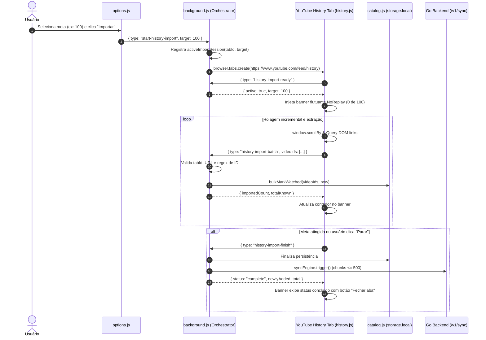

# YouTube History Import - Plan

## Goal Capsule

- **Objective:** Usuários do NoReplay conseguem importar seu histórico de vídeos assistidos do YouTube para o catálogo da extensão, garantindo que vídeos vistos antes da instalação do NoReplay sejam pulados automaticamente.
- **Means:** Botão de importação nas Opções do NoReplay que abre a página de histórico do YouTube (`https://www.youtube.com/feed/history`), executa extração incremental via rolagem com indicador visual flutuante e persiste os registros no catálogo local sincronizado.
- **Product authority:** Pedido do usuário registrado em sessão de brainstorm colaborativo.
- **Execution profile:** code.
- **Open blockers:** Nenhum.

## Product Contract

<!-- Product Contract unchanged -->

### Summary

Uma funcionalidade iniciada a partir da página de Opções do NoReplay que abre o histórico de reprodução do YouTube em uma nova aba, rola a página de forma automatizada para extrair os últimos X vídeos (ou até o fim do histórico) enquanto exibe um banner de progresso com opção de cancelamento, grava os identificadores no catálogo local como assistidos, dispara a sincronização com o servidor e mantém a aba aberta com o resumo final.

### Problem Frame

Ao instalar o NoReplay, o catálogo local de vídeos assistidos inicia vazio para novas instalações ou restrito apenas aos vídeos assistidos a partir da ativação da extensão. Usuários com meses ou anos de vídeos já assistidos no YouTube continuam vendo o NoReplay tratar esses vídeos antigos como novos ao abri-los. A única forma de popular o catálogo hoje é reproduzir ativamente cada vídeo novamente até atingir o limiar de 30 segundos ou 25%, criando atrito inicial e ausência de proteção para vídeos previamente consumidos.

### Key Decisions

- **Iniciação via página de Opções:** O ponto de partida é um controle explícito nas Opções da extensão que abre o histórico do YouTube em nova aba. *(session-settled: user-directed — chosen over banner fixo no YouTube ou scraping invisível: controle intencional do usuário sem poluição de UI no uso normal)*. Governs R1, R2.
- **Meta de importação configurável com parada manual:** O usuário pode escolher nas Opções um volume alvo (ex: 50, 100, 200 vídeos ou rolar até o fim) e interromper a rolagem a qualquer momento via banner. *(session-settled: user-directed — chosen over limite fixo estrito: flexibilidade para importações rápidas ou exaustivas)*. Governs R1, R4, R5.
- **Qualificação universal no histórico:** Todo vídeo presente na listagem de `/feed/history` é marcado como assistido, sem exigir percentual mínimo na barra de progresso do YouTube. *(session-settled: user-directed — chosen over filtrar apenas barras de progresso cheias: histórico do YouTube já reflete intenção de reprodução prévia)*. Governs R6.
- **Aba mantida aberta ao concluir:** Ao finalizar a extração ou atingir a meta, a aba do YouTube permanece aberta exibindo o banner de conclusão com métricas de importação e botão de fechar. *(session-settled: user-directed — chosen over fechamento automático imediato: visibilidade clara de sucesso e controle do usuário)*. Governs R7, R8.
- **Atualização atômica e disparo de sincronização:** Os vídeos extraídos são incorporados ao catálogo local e, se houver sessão autenticada ativa, a sincronização em nuvem é disparada respeitando os limites de lote. Governs R9, R10.

### Actors

- A1. Usuário: Configura a quantidade desejada de vídeos nas Opções, inicia a importação e acompanha o banner de progresso.
- A2. Extensão (Opções & Background): Orquestra a abertura da aba de histórico, recebe os lotes de IDs extraídos, atualiza o catálogo local e aciona a sincronização.
- A3. Content Script de Importação: Injetado na página de histórico do YouTube, gerencia o banner flutuante, executa rolagem suave periódica e extrai os IDs dos vídeos do DOM.
- A4. Servidor NoReplay (opcional): Recebe os novos registros assistidos através do endpoint de sincronização quando o usuário estiver autenticado.

### Requirements

#### Configuração e Disparo nas Opções

- R1. A página de Opções (`options.html`) deve disponibilizar uma seção de importação de histórico com seletor de quantidade (50, 100, 200 vídeos ou "Todos até parar") e um botão "Importar Histórico do YouTube".
- R2. Ao acionar o botão de importação, a extensão deve abrir `https://www.youtube.com/feed/history` em uma nova aba do navegador e ativar o modo de coleta nessa aba.

#### Interface e Feedback na Página do YouTube

- R3. Ao carregar a página de histórico no modo de coleta, deve ser renderizado um banner flutuante no topo ou canto superior direito da página do YouTube com identidade visual do NoReplay.
- R4. O banner flutuante deve exibir o progresso em tempo real ("Importando vídeos: X de Y coletados") e um botão para "Parar e salvar agora".
- R7. Ao concluir a coleta (seja por atingir a meta, pelo fim da listagem ou por parada manual), o banner deve atualizar para o estado concluído exibindo o total de vídeos processados (novos adicionados vs já existentes) e um botão "Fechar aba".
- R8. Se a página de histórico estiver vazia ou o usuário não estiver logado no YouTube, o banner deve detectar a ausência de vídeos após timeout razoável e exibir mensagem orientando o login.

#### Extração e Rolagem do DOM

- R5. O content script deve rolar a janela suavemente em intervalos controlados para acionar o carregamento dinâmico (infinite scroll) do YouTube até atingir a meta selecionada ou esgotar o histórico.
- R6. Cada card de vídeo na listagem do histórico deve ter seu identificador canônico extraído (a partir do link `/watch?v=...`) e ser considerado assistido.

#### Catálogo e Sincronização

- R9. Os vídeos extraídos devem ser enviados ao background script e mesclados no catálogo local (`storage.local`) com o estado `watched: true` e `watchedAt` correspondente ao momento da importação, preservando quaisquer exceções preexistentes (`neverSkip: true`).
- R10. Se o usuário estiver autenticado no NoReplay, a sincronização com o backend deve ser disparada automaticamente após a importação, dividindo em lotes se o volume de registros exceder o limite aceito pela API (500 registros por push).

### Key Flows

- F1. Importação bem-sucedida com meta atingida
  - **Trigger:** Usuário seleciona meta de 100 vídeos nas Opções e clica em "Importar Histórico do YouTube".
  - **Actors:** A1, A2, A3, A4
  - **Steps:**
    1. A2 abre aba em `https://www.youtube.com/feed/history`.
    2. A3 injeta o banner flutuante com status inicial (0 de 100).
    3. A3 lê os vídeos já presentes no DOM e rola a página para carregar novos elementos.
    4. Conforme novos cards aparecem, A3 envia IDs para A2 e atualiza o contador do banner.
    5. Ao atingir 100 vídeos, A3 interrompe a rolagem.
    6. A2 salva todos no catálogo local e aciona o motor de sincronização (se logado).
    7. A3 exibe mensagem de sucesso com métricas e botão para fechar a aba.
  - **Outcome:** Catálogo local e remoto atualizados; aba pronta para ser fechada pelo usuário.
  - **Covered by:** R1, R2, R3, R4, R5, R6, R7, R9, R10

- F2. Parada antecipada pelo usuário
  - **Trigger:** Usuário clica em "Parar e salvar agora" no banner antes de atingir a meta total.
  - **Actors:** A1, A2, A3
  - **Steps:**
    1. A3 cessa imediatamente as tentativas de rolagem da página.
    2. A3 notifica A2 para consolidar e gravar os vídeos extraídos até aquele momento.
    3. O banner muda para o estado final com o total coletado até o momento da parada.
  - **Outcome:** Todos os vídeos capturados até a interrupção são gravados com segurança.
  - **Covered by:** R4, R7, R9

- F3. Histórico inacessível ou não autenticado
  - **Trigger:** Aba do histórico aberta sem sessão ativa no YouTube ou com histórico pausado/vazio.
  - **Actors:** A1, A3
  - **Steps:**
    1. A3 monitora a presença de elementos de vídeo no DOM durante período limite (ex: 5 segundos).
    2. Nenhum elemento de histórico é detectado.
    3. A3 interrompe o fluxo e exibe no banner que não foi possível ler o histórico, recomendando fazer login no YouTube.
  - **Outcome:** Usuário orientado, nenhuma gravação indevida realizada.
  - **Covered by:** R8

### Acceptance Examples

- AE1. Importação com meta predefinida
  - **Covers R1, R5, R6, R9.**
  - **Given:** Usuário escolhe meta de 50 vídeos nas Opções.
  - **When:** A página de histórico é carregada e processada.
  - **Then:** Exatamente 50 vídeos são extraídos do DOM e gravados no catálogo local com `watched = true`.

- AE2. Preservação de vídeos marcados como neverSkip
  - **Covers R6, R9.**
  - **Given:** O vídeo `abc12345` já está no catálogo local com `neverSkip = true`.
  - **When:** A importação de histórico extrai novamente o vídeo `abc12345`.
  - **Then:** O registro mantém `neverSkip = true` e `neverSkipAt` original, sem sobrescrever a exceção do usuário.

- AE3. Usuário interrompe manualmente
  - **Covers R4, R7.**
  - **Given:** Importação em andamento com meta de 200 vídeos e 35 vídeos já coletados.
  - **When:** O usuário clica em "Parar e salvar agora".
  - **Then:** A rolagem cessa imediatamente e apenas os 35 vídeos já processados são salvos no catálogo.

- AE4. Histórico do YouTube não autenticado
  - **Covers R8.**
  - **Given:** Navegador em aba de histórico do YouTube sem login do Google.
  - **When:** O content script aguarda a renderização dos cards.
  - **Then:** O banner apresenta alerta informativo sobre a ausência de histórico e não inicia a rolagem infinita.

### Scope Boundaries

- **Deferred for later:**
  - Importação de arquivos Google Takeout (`watch-history.json` ou `watch-history.html`).
  - Importação de playlists específicas (ex: "Assistir mais tarde" ou playlists personalizadas).
  - Filtro por data ou período de tempo no histórico.
- **Outside this feature's identity:**
  - Limpar, pausar ou alterar itens dentro do histórico do YouTube.
  - Agendamento de scraping periódico autônomo sem ação explícita do usuário.

### Dependencies / Assumptions

- O usuário precisa ter uma conta no YouTube com histórico de exibição ativado e estar autenticado no YouTube no navegador durante o processo.
- A estrutura de seletores do DOM do YouTube (`ytd-video-renderer`, links com `href*="/watch?v="`) pode mudar com o tempo e precisará de seletores resilientes.
- O limite máximo por requisição de sincronização na API Go é de 500 registros (`server/internal/httpapi/sync_handlers.go`), logo grandes importações devem ser fatiadas pelo sync engine.

### Sources / Research

- `extension/storage/catalog.js`: Métodos de catálogo existentes (`update`, `markWatched`).
- `extension/sync/engine.js`: Mecanismo de sincronização entre catálogo local e servidor.
- `server/internal/httpapi/sync_handlers.go`: Limite de lote de push (`maxSyncBatchRecords = 500`).
- `extension/options/options.html`: Página de Opções da extensão onde a ação é disponibilizada.

---

## Planning Contract

### Key Technical Decisions

- **KTD1. Validação estrita da fronteira de confiança (Security Boundary):** As mensagens de lote de importação recebidas pelo background script verificam a URL real da aba (`browser.tabs.get`) garantindo que ela corresponda a `https://www.youtube.com/feed/history` ou `https://m.youtube.com/feed/history`, e cada identificador é validado contra o formato canônico de IDs do YouTube (`^[a-zA-Z0-9_-]{11}$`). *(session-settled: user-directed / AGENTS.md invariant)*. Governs R6, R9.
- **KTD2. Atualização em massa no Catalog Storage (`bulkMarkWatched`):** Adicionar método atômico em `extension/storage/catalog.js` para atualizar múltiplos vídeos em uma única leitura e gravação no `browser.storage.local`, evitando a sobrecarga de dezenas/centenas de acessos assíncronos sequenciais. Governs R9.
- **KTD3. Fatiamento de lote no motor de sincronização (`syncEngine.push` chunking):** O `syncEngine` em `extension/sync/engine.js` divide listas de envio que ultrapassem 500 registros em fatias consecutivas de até 500 itens, em conformidade estrita com o limite `maxSyncBatchRecords = 500` do servidor Go (`server/internal/httpapi/sync_handlers.go`). Governs R10.
- **KTD4. Orquestrador de sessão de importação no Background (`history-orchestrator`):** O background mantém o estado da sessão de importação ativa associada ao `tabId`, repassando a meta configurada, recebendo lotes parciais, controlando o término e provendo mensagens de encerramento de aba. Governs R1, R2, R4, R7.
- **KTD5. Content Script modular de extração e banner flutuante (`history-importer`):** Um content script dedicado e arquivo de estilo associado (`content/history.js`, `content/history.css`, `lib/history-core.js`) injetado especificamente na rota de histórico, desacoplado dos scripts de reprodução de vídeo (`content/skip.js`). Governs R3, R4, R5, R6, R7, R8.

### High-Level Technical Design



### Risks & Dependencies

- **Variações do DOM do YouTube:** O YouTube pode alterar os nós de renderização de cards (`ytd-video-renderer`, `ytd-rich-item-renderer`). **Mitigação:** `lib/history-core.js` busca links de vídeo canônicos usando seletores genéricos e resilientes (`a[href*="/watch?v="]`), com de-duplicação por `Set`.
- **Throttling ou bloqueio por rolagem contínua:** Rolar a página rápido demais pode causar engasgos no navegador ou delay de carregamento do YouTube. **Mitigação:** Intervalos de rolagem espaçados (ex: 400-600ms) com verificação de estabilidade do DOM antes do próximo scroll.
- **Limite de push no backend:** O servidor Go rejeita com `400 batch_too_large` qualquer requisição com mais de 500 registros. **Mitigação:** KTD3 garante fatiamento estrito em lotes de até 500 registros no `syncEngine`.

---

## Implementation Units

### U1. Suporte a Atualização em Lote no Catálogo e Chunking no Sync Engine

- **Goal:** Habilitar persistência eficiente em lote no armazenamento local da extensão e garantir que o envio de catálogos volumosos para o backend seja fatiado em lotes de no máximo 500 registros.
- **Requirements:** R9, R10.
- **Files touched:**
  - `extension/storage/catalog.js`
  - `extension/sync/engine.js`
  - `extension/tests/catalog.test.js`
  - `extension/tests/sync.test.js`
- **Approach:**
  1. Em `catalog.js`, adicionar função `bulkMarkWatched(videoIds, at)` que executa uma única leitura `readAll()`, itera sobre a lista de IDs aplicando `{ watched: true, watchedAt: at }` respeitando monotonicidade e exceções existentes (`neverSkip`), e grava uma única vez em `storageArea.set({ [CATALOG_KEY]: all })`.
  2. Em `sync/engine.js`, ajustar a função `push` para que, ao mapear `catalog.list()`, se `records.length > 500`, envie os registros em lotes sequenciais de 500 registros cada via `client.push(token, batch)`, interrompendo e propagando erro caso algum lote falhe.
  3. Adicionar testes unitários em `catalog.test.js` cobrindo `bulkMarkWatched` (preservação de `neverSkip`, timestamps crescentes) e em `sync.test.js` cobrindo envio de mais de 500 itens dividido em múltiplos batches.
- **Test Scenarios:**
  - TS1.1: `bulkMarkWatched` com lista de 100 IDs novos grava todos com `watched: true`.
  - TS1.2: `bulkMarkWatched` não altera `neverSkip: true` em IDs preexistentes com exceção (AE2).
  - TS1.3: `syncEngine.trigger()` com 750 registros no catálogo dispara 2 chamadas de push (500 + 250) para o cliente.
- **Verification:** `cd extension && npm test`

### U2. Lógica de Extração e Validação do Histórico (`lib/history-core.js`)

- **Goal:** Criar módulo puro para extrair IDs de vídeo de nós/URLs do histórico do YouTube e validar identificadores de forma segura.
- **Requirements:** R5, R6.
- **Files touched:**
  - `extension/lib/history-core.js`
  - `extension/tests/history-core.test.js`
- **Approach:**
  1. Criar `extension/lib/history-core.js` com funções puras:
     - `isValidVideoId(id)`: valida `^[a-zA-Z0-9_-]{11}$`.
     - `extractHistoryVideoIds(elementsOrHrefs)`: itera sobre strings ou links, extrai IDs usando `extractVideoId`, valida e elimina duplicatas preservando a ordem cronológica de descoberta.
     - `isHistoryUrl(url)`: verifica se a URL pertence a `https://www.youtube.com/feed/history` ou `https://m.youtube.com/feed/history`.
  2. Implementar suite de testes em `tests/history-core.test.js` cobrindo URLs válidas, links com timestamps (`&t=`), links inválidos ou nulos.
- **Test Scenarios:**
  - TS2.1: `extractHistoryVideoIds` extrai IDs únicos de links variados do YouTube (`/watch?v=11chars...`, `/watch?v=...&t=10s`).
  - TS2.2: Rejeita IDs maliciosos ou links com query params adulterados.
  - TS2.3: `isHistoryUrl` retorna true apenas para URLs legítimas do feed de histórico.
- **Verification:** `cd extension && npm test`

### U3. Orquestrador de Importação no Background Script

- **Goal:** Gerenciar ciclo de vida da sessão de importação, validar chamadas recebidas da aba de histórico e disparar persistência e sincronização.
- **Requirements:** R1, R2, R4, R7, R9, R10.
- **Files touched:**
  - `extension/lib/background.js`
  - `extension/tests/background.test.js` ou `extension/tests/history-import.test.js`
- **Approach:**
  1. No background, manter estrutura de sessão ativa: `{ activeTabId, targetCount, importedIds: Set }`.
  2. Tratar mensagens do runtime:
     - `start-history-import`: recebe `{ targetCount }`, chama `browser.tabs.create({ url: "https://www.youtube.com/feed/history" })`, registra o ID da nova aba como `activeTabId`.
     - `history-import-ready`: originada pelo content script; verifica se `sender.tab.id === activeTabId`; se sim, responde com a configuração da sessão (`{ active: true, targetCount }`).
     - `history-import-batch`: valida que o remetente é `activeTabId`, confirma com `browser.tabs.get` que a URL da aba é o histórico do YouTube (KTD1), valida IDs, executa `catalog.bulkMarkWatched`, acumula métricas e responde com total importado.
     - `history-import-finish`: finaliza a sessão ativa e executa `triggerSync()`.
     - `close-tab`: fecha a aba do remetente via `browser.tabs.remove(sender.tab.id)`.
  3. Adicionar testes simulando o ciclo completo com `fake-browser`.
- **Test Scenarios:**
  - TS3.1: Mensagens de batch vindas de abas não autorizadas ou com URLs fora de `/feed/history` são ignoradas ou rejeitadas.
  - TS3.2: Ao receber `start-history-import`, cria nova aba na URL de histórico e registra sessão.
  - TS3.3: Lotes válidos persistem vídeos e chamam `triggerSync` no encerramento.
- **Verification:** `cd extension && npm test`

### U4. Content Script do Histórico e Banner Flutuante

- **Goal:** Injetar na página de histórico do YouTube o banner visual de progresso, coordenar a rolagem da página e despachar os lotes de vídeos encontrados.
- **Requirements:** R3, R4, R5, R6, R7, R8.
- **Files touched:**
  - `extension/content/history.js`
  - `extension/content/history.css`
  - `extension/manifest.json`
- **Approach:**
  1. Criar `content/history.css` estilizando o banner flutuante `#noreplay-history-banner` (fixado no topo/canto superior direito com barra de progresso, botão "Parar e salvar", contador e botão de fechar).
  2. Criar `content/history.js` que:
     - Envia mensagem `history-import-ready` ao background ao carregar.
     - Se a sessão não estiver ativa para essa aba, não faz nada.
     - Se ativa, injeta o banner flutuante no DOM.
     - Inicia intervalo de rolagem (`window.scrollBy({ top: 1200, behavior: 'smooth' })`).
     - A cada ciclo, coleta links de vídeo usando `extractHistoryVideoIds`.
     - Envia novos IDs encontrados em lotes para o background via `history-import-batch`.
     - Atualiza o banner com a contagem atual ("X de Y vídeos coletados").
     - Se atingir a meta configurada ou se não houver novos vídeos após várias tentativas de rolagem, encerra a rolagem, chama `history-import-finish` e atualiza o banner para o estado final com botão "Fechar aba".
     - Se o DOM não tiver nenhum vídeo após timeout inicial (ex: 5s), exibe alerta orientando login (R8).
  3. Atualizar `manifest.json` para registrar `content/history.js` e `content/history.css` em páginas `https://www.youtube.com/feed/history*` e `https://m.youtube.com/feed/history*`.
- **Test Scenarios:**
  - TS4.1: Banner é injetado com elementos de status e botão de cancelamento.
  - TS4.2: Clique em "Parar e salvar" encerra imediatamente os timers de rolagem e aciona finalização (AE3).
  - TS4.3: Detecção de ausência de vídeos após timeout exibe mensagem informativa de login (AE4).
- **Verification:** `cd extension && npm test && npm run lint:manifest`

### U5. Interface de Usuário nas Opções e Validação End-to-End

- **Goal:** Integrar o formulário de disparo nas Opções do NoReplay com seletor de quantidade e validar manifest e suite de testes completa.
- **Requirements:** R1, R2.
- **Files touched:**
  - `extension/options/options.html`
  - `extension/options/options.js`
  - `extension/tests/options.test.js`
- **Approach:**
  1. Em `options.html`, adicionar card "Importar histórico do YouTube" com seletor (`<select id="history-target">` com opções 50, 100, 200, 0 para ilimitado) e botão `#start-import-btn`.
  2. Em `options.js`, escutar o clique no botão e enviar `browser.runtime.sendMessage({ type: "start-history-import", targetCount: Number(target) })`, exibindo status "Histórico aberto em nova aba...".
  3. Atualizar testes unitários de opções em `tests/options.test.js`.
  4. Executar bateria de checagens: `npm test`, `npm run lint`, `npm run lint:manifest` na extensão e `go test ./...`, `go vet ./...` no servidor.
- **Test Scenarios:**
  - TS5.1: Seletor de opções renderiza valores padrão e envia mensagem correta ao background.
  - TS5.2: Feedback textual de abertura de aba é exibido após o clique.
  - TS5.3: Validação de manifesto passa sem avisos pelo `web-ext lint`.
- **Verification:**
  - `cd extension && npm test && npm run lint && npm run lint:manifest`
  - `cd server && go test ./... && go vet ./...`

---

## Verification Contract

### Test Execution Commands

1. **Extension Unit & Integration Tests:**
   ```bash
   cd extension
   npm test
   ```
2. **Extension Lint & Manifest Validation:**
   ```bash
   cd extension
   npm run lint
   npm run lint:manifest
   ```
3. **Backend Static Analysis & Tests:**
   ```bash
   cd server
   go test ./...
   go vet ./...
   ```

### Quality Gates

- Nenhuma regressão nas suites existentes de skip, catalog e sync da extensão.
- Cobertura de testes unitários para os novos métodos `bulkMarkWatched` e `history-core`.
- Manifesto MV3 estritamente válido segundo `npx web-ext lint`.
- Nenhuma quebra no limite de lote do servidor Go durante sincronizações volumosas.

---

## Definition of Done

1. **Requisitos atendidos:** Todos os requisitos R1 até R10 implementados e rastreáveis.
2. **Segurança garantida:** Nenhuma mensagem do content script é aceita sem verificação da URL da aba pelo background e validação estrita do formato de ID do YouTube.
3. **Sincronização íntegra:** Catálogo local grava em lote monotonicamente preservando exceções (`neverSkip`), e o envio ao servidor é fatiado em lotes <= 500 registros.
4. **Verificação limpa:** `npm test`, `npm run lint`, `npm run lint:manifest` e `go test ./...` passam com 100% de sucesso.
5. **Código limpo:** Nenhum código ou arquivo de rascunho temporário mantido na árvore do repositório.
