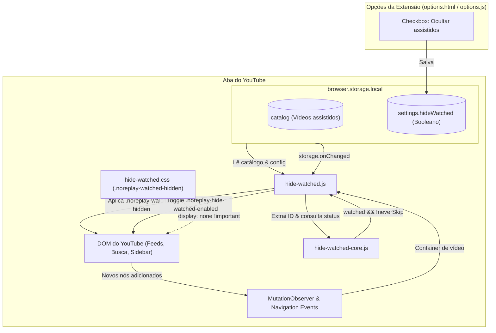
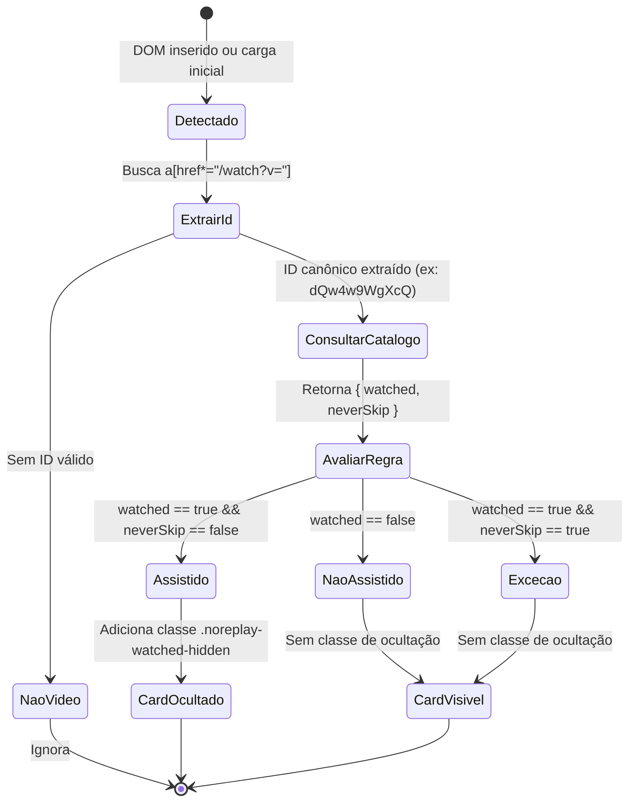
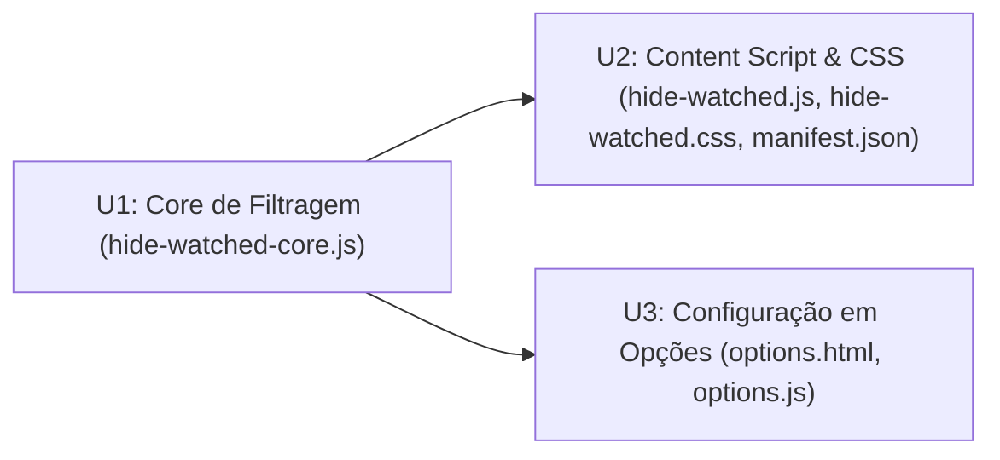

# Ocultação de Vídeos Já Assistidos nas Páginas do YouTube

## Goal Capsule

- **Objective:** Eliminar a poluição visual e o retrabalho cognitivo ao navegar pelo YouTube, ocultando por completo os cards de vídeos já assistidos em todas as listagens e recomendações, mantendo a navegação fluida e o reflow natural da grade.
- **Means:** Aplicar ocultação via CSS (`display: none`) nos containers dos cards de vídeo através de content script integrado ao catálogo local do NoReplay.
- **Product Authority:** Este documento especifica o comportamento de exibição nas páginas do YouTube com base no catálogo do NoReplay. Não altera dados de histórico da conta do YouTube, nem modifica regras de sincronização backend ou fluxo de skip do player.
- **Open Blockers:** Nenhum.

---

## Product Contract

> Product Contract unchanged.

### Summary

Ocultação automática de vídeos já assistidos em todas as listagens do YouTube (Página Inicial, Inscrições, Busca, Canais e Sidebar do player). Os cards de vídeos assistidos são colapsados integralmente via CSS (`display: none`), permitindo que a grade nativa do YouTube se reorganize sem buracos vazios, preservando exceções marcadas com "Nunca pular" e disponibilizando um controle liga/desliga nas opções da extensão.

### Problem Frame

Ao explorar o YouTube em busca de conteúdo novo, o algoritmo frequentemente recomenda vídeos que o usuário já assistiu por completo. Esses cards disputam atenção visual, poluem a grade e exigem filtragem mental contínua. Manter apenas um indicador sutil ou esvaziar a miniatura ainda ocupa o espaço da tela; colapsar o card por completo devolve o foco unicamente aos conteúdos inéditos.

### Key Decisions

- **KD1: Colapso total do card (`display: none`) como tratamento visual.**
  (session-settled: user-directed — chosen over buraco na thumbnail, esmaecimento/ghost e linha compacta: usuário avaliou as 4 opções em protótipo visual e escolheu colapso total para manter a grade 100% limpa)
  Governs R1, R2.

- **KD2: Cobertura ampla em todas as listagens de vídeos do YouTube.**
  (session-settled: user-directed — chosen over limitar a Home/Inscrições ou poupar a sidebar do watch: usuário optou por cobertura completa em feeds, buscas, canais e recomendações laterais)
  Governs R3.

- **KD3: Prevalência da exceção "Nunca pular" (`neverSkip: true`).**
  (session-settled: user-directed — chosen over ocultação cega de todos os assistidos: vídeos marcados para não pular permanecem visíveis)
  Governs R4.

- **KD4: Rolagem e paginação naturais.**
  (session-settled: user-directed — chosen over auto-trigger/scroll programático forçado: o carregamento de mais itens aguarda a rolagem natural do usuário)
  Governs R5.

- **KD5: Configuração de controle liga/desliga nas Opções da extensão.**
  (session-settled: user-directed — chosen over funcionalidade rígida sem chave: usuário escolheu disponibilizar switch com padrão ativado)
  Governs R6.

- **KD6: Reatividade dinâmica a adições no DOM e atualizações do catálogo.**
  Governs R7, R8.

### Requirements

#### Comportamento de Ocultação e Apresentação

- R1. Quando a funcionalidade estiver ativada, qualquer card de vídeo identificado como assistido (`watched: true`) no catálogo do NoReplay deve ser ocultado completamente através de regra de estilo (`display: none`), permitindo que os cards adjacentes preencham o espaço vazio. Governed by KD1.
- R2. A ocultação deve colapsar o container raiz do card (ex.: nós de grid/lista do YouTube), sem deixar espaços vazios, margens residuais ou separadores órfãos na grade. Governed by KD1.
- R3. A ocultação deve ser aplicada em todas as superfícies de listagem de vídeos do YouTube: Página Inicial (`/`), Inscrições (`/feed/subscriptions`), Resultados de busca (`/results`), Listas de vídeos em canais (`/@.../videos` e abas de conteúdo) e Sidebar de recomendações no player (`/watch`). Governed by KD2.
- R4. Se um vídeo possuir a flag `neverSkip: true` no catálogo, ele deve permanecer visível, mesmo que já tenha sido assistido (`watched: true`). Governed by KD3.
- R5. O mecanismo não deve disparar rolagens de página automáticas nem programáticas quando muitos vídeos forem ocultados em sequência; novos lotes de vídeos são carregados quando o usuário rolar a página normalmente. Governed by KD4.

#### Configuração e Controle

- R6. A página de Opções da extensão (`options/options.html`) deve disponibilizar uma chave liga/desliga ("Ocultar vídeos já assistidos"), com valor padrão ativado (`true`), persistida em `browser.storage.local`. Governed by KD5.

#### Ciclo de Vida e Reatividade

- R7. Novos cards de vídeos injetados dinamicamente na página via scroll infinito ou navegação interna (SPA) do YouTube devem ser processados e ocultados sem atraso perceptível nem oscilações visuais duradouras (flicker). Governed by KD6.
- R8. Atualizações no catálogo ocorridas em segundo plano (como término de reprodução em outra aba ou conclusão de sincronização com o servidor) devem atualizar a visibilidade dos cards exibidos na página sem necessidade de recarregamento manual. Governed by KD6.

### Key Flows

- F1. Carregamento inicial de página de feed
  - **Trigger:** Usuário acessa o YouTube ou navega para `/feed/subscriptions`.
  - **Actors:** Usuário, Content Script NoReplay, Catálogo Local.
  - **Steps:** Content script lê a configuração de ocultação; se ativada, consulta o catálogo para os IDs dos vídeos renderizados na página; adiciona classe/estilo de ocultação aos containers cujos IDs constam como `watched: true` e `neverSkip: false`.
  - **Outcome:** Apenas vídeos não assistidos ou com exceção "Nunca pular" são exibidos na grade.
  - **Covered by:** R1, R2, R3, R4, R6.

- F2. Rolagem infinita carregando novos lotes de vídeos
  - **Trigger:** Usuário rola a página e o YouTube injeta novos elementos de vídeo no DOM.
  - **Actors:** YouTube SPA, MutationObserver do Content Script.
  - **Steps:** Observer detecta nós de vídeo adicionados ao container; extrai os IDs dos links `/watch?v=...`; verifica o status no catálogo local; aplica ocultação instantaneamente nos assistidos.
  - **Outcome:** Novos itens assistidos são colapsados assim que chegam ao DOM sem quebrar o layout.
  - **Covered by:** R1, R2, R5, R7.

- F3. Catálogo atualizado em segundo plano
  - **Trigger:** Um vídeo é marcado como assistido em outra aba ou a sincronização com o servidor é concluída.
  - **Actors:** Background Script, `browser.storage.onChanged`, Content Script.
  - **Steps:** Content script escuta mudanças na chave do catálogo ou recebe mensagem de atualização; reavalia os vídeos presentes na página; oculta imediatamente qualquer novo vídeo assistido.
  - **Outcome:** A tela aberta se mantém alinhada com o catálogo sem exigir refresh.
  - **Covered by:** R8.

- F4. Alteração de preferência nas Opções
  - **Trigger:** Usuário desativa ou reativa a chave "Ocultar vídeos já assistidos" nas Opções da extensão.
  - **Actors:** Usuário, `options.js`, Content Script.
  - **Steps:** A preferência é salva em `storage.local`; abas ativas do YouTube detectam a mudança e removem ou reaplicam as classes de ocultação em todos os cards.
  - **Outcome:** Visibilidade original do YouTube é restaurada ou reocultada em tempo real.
  - **Covered by:** R6, R8.

### Acceptance Examples

- AE1. Card de vídeo assistido no feed principal é ocultado
  - **Covers:** R1, R2, R3
  - **Given:** A opção de ocultação está ativada e o vídeo `dQw4w9WgXcQ` está marcado como assistido (`watched: true`, `neverSkip: false`) no catálogo.
  - **When:** O usuário navega para a página inicial do YouTube (`https://www.youtube.com/`).
  - **Then:** O container do card desse vídeo não é exibido (`display: none`), e o card seguinte ocupa naturalmente a sua posição no grid.

- AE2. Vídeo assistido com exceção "Nunca pular" continua visível
  - **Covers:** R4
  - **Given:** O vídeo `abc123xyz89` está marcado no catálogo com `watched: true` e `neverSkip: true`.
  - **When:** O card do vídeo é carregado na busca ou no feed de inscrições.
  - **Then:** O card é mantido totalmente visível na grade com sua thumbnail e metadados habituais.

- AE3. Desativação temporária da funcionalidade
  - **Covers:** R6
  - **Given:** Há vídeos assistidos ocultados na página inicial do YouTube.
  - **When:** O usuário desmarca a opção "Ocultar vídeos já assistidos" na página de Opções.
  - **Then:** Os cards anteriormente ocultados tornam-se imediatamente visíveis na página sem necessidade de recarregar a aba (`F5`).

### Scope Boundaries

- **In Scope:**
  - Ocultação completa (`display: none`) de cards de vídeo assistidos nas páginas Home, Subscriptions, Search, Channels e Sidebar do Watch.
  - Preservação da exibição para vídeos com `neverSkip: true`.
  - Configuração liga/desliga persistida em `browser.storage.local` com UI na página de Opções.
  - Observador de mutação DOM e sincronização reativa com mudanças no catálogo.
- **Deferred for Later:**
  - Atalho de teclado rápido para alternar a exibição de assistidos sem abrir a tela de Opções.
  - Filtros avançados por duração, palavras-chave ou canais específicos.
- **Outside this Product's Identity (Non-goals):**
  - Modificar dados de histórico ou recomendações na conta Google/YouTube do usuário.
  - Manipulação forçada do scroll do navegador para compensar lotes ocultados.
  - Criação de novos endpoints ou migrações de banco no backend Go (o catálogo sincronizado existente atende integralmente à demanda).

### Dependencies and Assumptions

- D1. Estrutura de armazenamento local do NoReplay (`browser.storage.local`) e API de catálogo já existente em `extension/storage/catalog.js`.
- D2. Seletores estáveis de elementos de listagem do YouTube no Firefox (`ytd-rich-item-renderer`, `ytd-video-renderer`, `ytd-compact-video-renderer`, `ytd-grid-video-renderer` e equivalentes mobile `ytm-*`).
- A1. A manipulação de visibilidade via classe CSS com `display: none !important` no elemento container do card aciona o cálculo de layout nativo do CSS Grid / Flexbox do YouTube sem falhas visuais.

### Success Criteria

- SC1. Navegação limpa: Nenhum vídeo marcado como assistido (sem `neverSkip`) permanece visível na tela inicial ou em canais quando a opção estiver ativada.
- SC2. Estabilidade visual: Não ocorrem saltos ou trepidações perceptíveis após o carregamento inicial da página nem durante o scroll contínuo.
- SC3. Autonomia e controle: O usuário consegue ligar ou desligar a ocultação a qualquer momento na tela de Opções com efeito imediato nas abas abertas.

---

## Planning Contract

### Key Technical Decisions

- **KTD1: Arquitetura UMD / Pure Core + Content Script Adapter**
  Separar a lógica de parsing e decisão de ocultação em `extension/lib/hide-watched-core.js` (funções puras sem dependência direta de APIs proprietárias do navegador, testáveis com `node:test`) e manter a orquestração de DOM, eventos e storage em `extension/content/hide-watched.js`. Segue o padrão já consolidado no projeto (`lib/skip-core.js` e `content/skip.js`).
  Governs R1, R2, R4.

- **KTD2: Alternância instantânea via classe raiz no `body`**
  Em vez de percorrer e alterar manualmente o estilo inline de centenas de nós ao ligar ou desligar a preferência, o estado ativo/inativo é refletido na classe `noreplay-hide-watched-enabled` no elemento `document.body` (ou `document.documentElement`). A regra CSS `.noreplay-hide-watched-enabled .noreplay-watched-hidden { display: none !important; }` garante comutação global em O(1).
  Governs R1, R6.

- **KTD3: Reatividade Híbrida: MutationObserver + `browser.storage.onChanged`**
  O content script observa adições de nós ao DOM através de `MutationObserver` (filtrando nós filhos de containers de feeds/grid) para marcar novos cards que entram via infinite scroll. Simultaneamente, um listener em `browser.storage.onChanged` monitora tanto a chave do catálogo (`catalog`) quanto a chave de configuração (`settings.hideWatched`), atualizando o DOM imediatamente sem recarregar a página.
  Governs R7, R8.

- **KTD4: Mapa de Seletores Declarativo e Resiliente**
  Os containers de cards de vídeo variam por tipo de página do YouTube. Declaramos uma lista fixa e prioritária de seletores de container:
  - Desktop Home / Subscriptions / Channels: `ytd-rich-item-renderer`, `ytd-grid-video-renderer`
  - Desktop Search: `ytd-video-renderer`
  - Desktop Watch Sidebar: `ytd-compact-video-renderer`
  - Mobile (m.youtube.com): `ytm-video-with-context-renderer`, `ytm-compact-video-renderer`
  Dentro de cada container, a busca da âncora `a[href*="/watch?v="]` extrai o ID canônico via `extractVideoId` ou regex de 11 caracteres.
  Governs R3.

- **KTD5: Chave de Configuração em `browser.storage.local`**
  A preferência do usuário é armazenada sob a chave `settings.hideWatched` (booleano). O valor padrão quando ausente ou não definido é `true`.
  Governs R6.

### High-Level Technical Design

#### Arquitetura de Componentes e Fluxo de Dados



#### Ciclo de Vida de Avaliação de Cards



### Output Structure

```text
extension/
├── lib/
│   └── hide-watched-core.js      # Novo: funções puras de extração, decisão e seletores
├── content/
│   ├── hide-watched.css          # Novo: regra display:none para .noreplay-watched-hidden
│   └── hide-watched.js           # Novo: content script com MutationObserver e storage listener
├── options/
│   ├── options.html              # Modificado: adição do toggle 'Ocultar vídeos já assistidos'
│   └── options.js                # Modificado: bind e persistência de settings.hideWatched
├── manifest.json                 # Modificado: registro de scripts e estilos de hide-watched
└── tests/
    ├── hide-watched-core.test.js # Novo: testes unitários para o core de decisão e seletores
    └── options.test.js           # Modificado: testes da configuração settings.hideWatched
```

### Sequencing and Dependencies



---

## Implementation Units

### U1. Core de Identificação e Filtragem (`hide-watched-core.js`)

- **Objective:** Fornecer funções puras e utilitárias para extração de IDs de vídeo de elementos ou links do YouTube, mapa de seletores de containers suportados, e avaliação do estado de visibilidade baseado nos registros do catálogo e configurações.
- **Files:**
  - `extension/lib/hide-watched-core.js`
  - `extension/tests/hide-watched-core.test.js`
- **Requirements Covered:** R1, R2, R4 (Covers R1, R2, R4; Governed by KTD1, KTD4)
- **Key Technical Decisions:** KTD1, KTD4
- **Technical Design:**
  - Exportar UMD compatível com Node.js e navegador (como `lib/skip-core.js`).
  - `CONTAINER_SELECTORS`: array com `ytd-rich-item-renderer`, `ytd-video-renderer`, `ytd-compact-video-renderer`, `ytd-grid-video-renderer`, `ytm-video-with-context-renderer`, `ytm-compact-video-renderer`.
  - `extractVideoIdFromElement(container)`: busca âncoras com `href*="/watch"` e extrai o ID de 11 caracteres.
  - `shouldHideVideo(record, isFeatureEnabled)`: retorna `true` se `isFeatureEnabled === true`, `record.watched === true` e `record.neverSkip === false`. Retorna `false` em caso contrário.
- **Test Scenarios:**
  - TS1.1: `shouldHideVideo` retorna `true` apenas quando a funcionalidade está ativa, `watched: true` e `neverSkip: false`.
  - TS1.2: `shouldHideVideo` retorna `false` quando `neverSkip: true`, mesmo com `watched: true`.
  - TS1.3: `shouldHideVideo` retorna `false` quando o registro é nulo, indefinido ou `watched: false`.
  - TS1.4: `shouldHideVideo` retorna `false` quando `isFeatureEnabled: false`, independentemente do catálogo.
  - TS1.5: `extractVideoIdFromElement` extrai corretamente IDs válidos de tags `<a>` aninhadas e ignora links para canais, playlists ou URLs inválidas.

### U2. Content Script e Estilos de Ocultação (`hide-watched.js`, `hide-watched.css`)

- **Objective:** Integrar o core ao DOM do YouTube, orquestrando `MutationObserver` para capturar lotes de cards em tempo real, aplicando a classe `.noreplay-watched-hidden`, gerenciando a classe global no `body` e escutando `browser.storage.onChanged`.
- **Files:**
  - `extension/content/hide-watched.css`
  - `extension/content/hide-watched.js`
  - `extension/manifest.json`
- **Requirements Covered:** R1, R2, R3, R5, R7, R8 (Covers R1, R2, R3, R5, R7, R8; Governed by KTD2, KTD3, KTD4)
- **Key Technical Decisions:** KTD2, KTD3, KTD4
- **Technical Design:**
  - Em `content/hide-watched.css`:
    ```css
    body.noreplay-hide-watched-enabled .noreplay-watched-hidden {
      display: none !important;
    }
    ```
  - Em `content/hide-watched.js`:
    - Inicialização assíncrona: lê `settings.hideWatched` (default true) e `catalog` de `browser.storage.local`.
    - Atualiza `body.classList.toggle('noreplay-hide-watched-enabled', isEnabled)`.
    - Executa varredura inicial no DOM existente para aplicar `.noreplay-watched-hidden` aos cards assistidos.
    - Instancia `MutationObserver` no container principal de conteúdo (ou `document.body` com debounce leve de microtask) para processar novos nós correspondentes aos `CONTAINER_SELECTORS`.
    - Adiciona listener em `browser.storage.onChanged`:
      - Se `settings.hideWatched` mudar, atualiza a classe no `body`.
      - Se `catalog` mudar, reavalia os nós já mapeados ou presentes na página para adicionar/remover `.noreplay-watched-hidden`.
  - Em `manifest.json`: registrar `lib/hide-watched-core.js`, `content/hide-watched.js` e `content/hide-watched.css` no bloco de `content_scripts` para `https://www.youtube.com/*` e `https://m.youtube.com/*`.
- **Test Scenarios:**
  - TS2.1: Content script inicializa com a configuração e adiciona `noreplay-hide-watched-enabled` no body quando ativado.
  - TS2.2: Elementos que entram no DOM via mutação e contêm ID de vídeo assistido recebem `.noreplay-watched-hidden`.
  - TS2.3: Quando `browser.storage.onChanged` dispara para o `catalog`, cards com novos IDs assistidos ganham a classe de ocultação instantaneamente.
  - TS2.4: Quando `browser.storage.onChanged` altera `settings.hideWatched` para `false`, a classe do body é removida e os cards voltam a ser exibidos.
  - TS2.5: `npm run lint:manifest` valida o `manifest.json` sem erros ou alertas de schema.

### U3. Configuração e Persistência na Página de Opções (`options.html`, `options.js`)

- **Objective:** Permitir ao usuário habilitar ou desabilitar a ocultação de vídeos assistidos na interface de configurações de forma intuitiva e reativa.
- **Files:**
  - `extension/options/options.html`
  - `extension/options/options.js`
  - `extension/tests/options.test.js`
- **Requirements Covered:** R6 (Covers R6; Governed by KTD5)
- **Key Technical Decisions:** KTD5
- **Technical Design:**
  - Em `options/options.html`: adicionar uma seção de preferências com checkbox/toggle `<input type="checkbox" id="setting-hide-watched">` com label "Ocultar vídeos já assistidos dos feeds e recomendações".
  - Em `options/options.js`:
    - Na inicialização, lê `settings.hideWatched` de `browser.storage.local` (default: `true`) e reflete no `checked` do input.
    - No evento `change`, grava o novo valor booleano em `browser.storage.local.set({ "settings.hideWatched": checked })`.
- **Test Scenarios:**
  - TS3.1: Página de opções inicializa o checkbox como marcado (`true`) caso a chave não esteja presente no storage.
  - TS3.2: Página de opções lê o valor persistido (`false`) e reflete o checkbox desmarcado.
  - TS3.3: Alternar o checkbox persiste o novo valor no storage local sob a chave `settings.hideWatched`.

---

## Verification Contract

### Comandos de Validação Automatizada

```bash
cd extension
npm test                 # Executa suíte completa node:test incluindo novos testes de core e options
npm run lint             # Executa ESLint sem erros
npm run lint:manifest    # Valida Manifest V3 via web-ext lint
```

### Critérios de Sucesso e Portões de Qualidade

1. `npm test` passa com 100% de sucesso sem regressões nos testes existentes (`history-core`, `skip`, `progress`, `catalog`, etc.).
2. `npm run lint` não acusa violações de estilo nem variáveis indefinidas.
3. `npm run lint:manifest` retorna zero erros para a injeção dos novos scripts e CSS.
4. Nenhuma mutação de DOM no YouTube gera exceções no console do navegador (`console.error`).

---

## Definition of Done

- [ ] `lib/hide-watched-core.js` implementado com suporte UMD e coberto por testes em `tests/hide-watched-core.test.js`.
- [ ] `content/hide-watched.css` e `content/hide-watched.js` implementados com MutationObserver resiliente e listeners de storage.
- [ ] `options/options.html` e `options/options.js` atualizados com toggle persistente e testes em `tests/options.test.js`.
- [ ] `manifest.json` atualizado e validado com `npm run lint:manifest`.
- [ ] Todos os comandos de `npm test`, `npm run lint` e `npm run lint:manifest` executados com sucesso.
